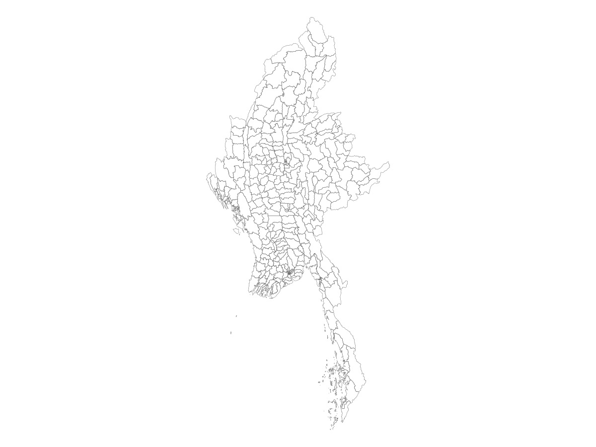
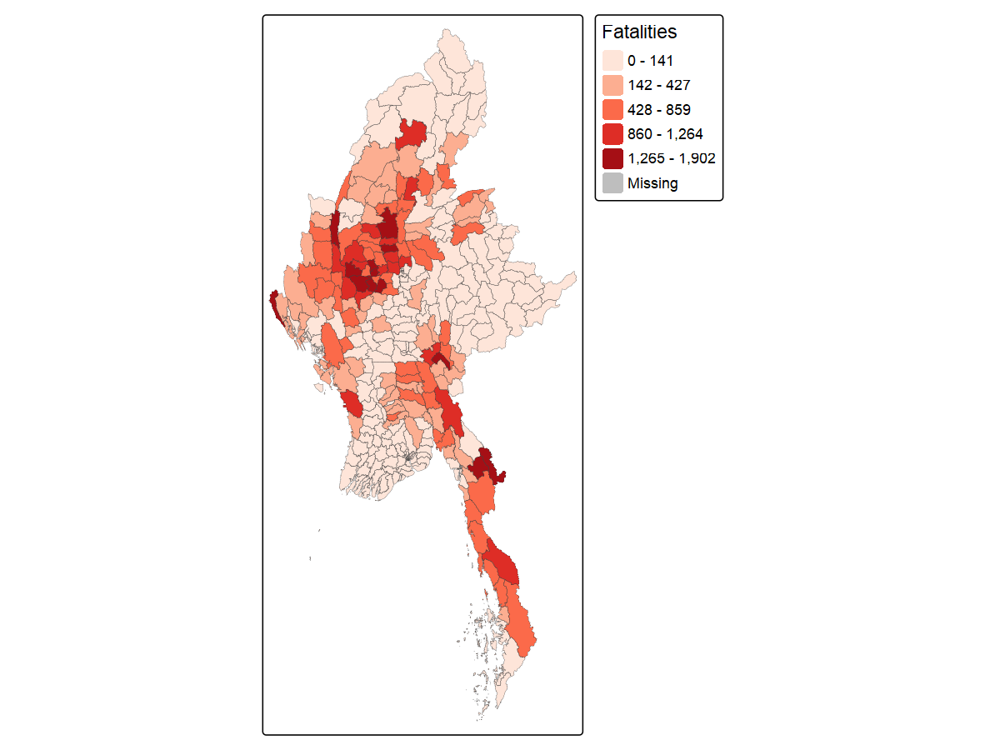
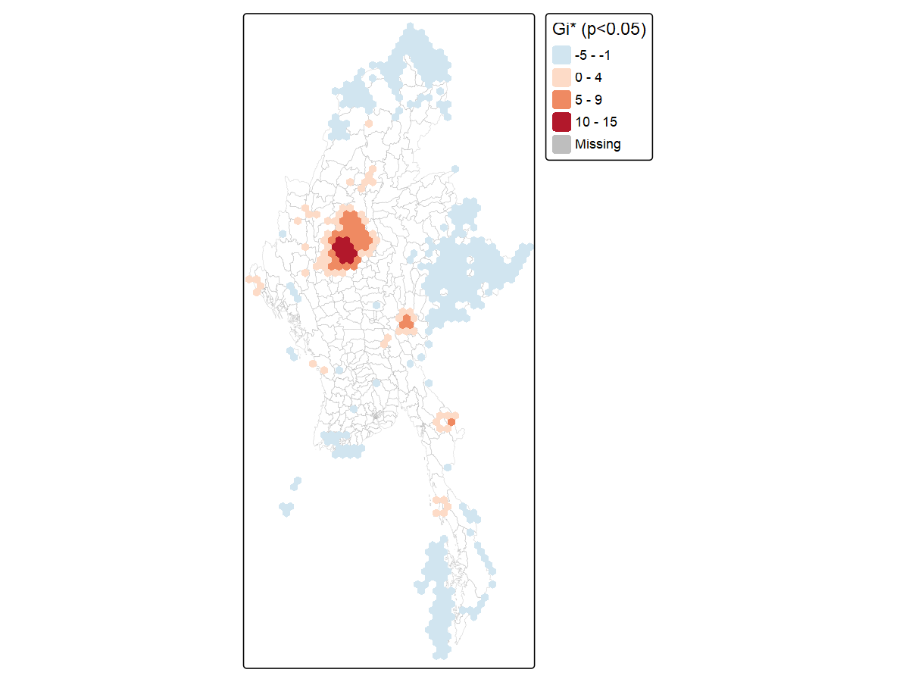
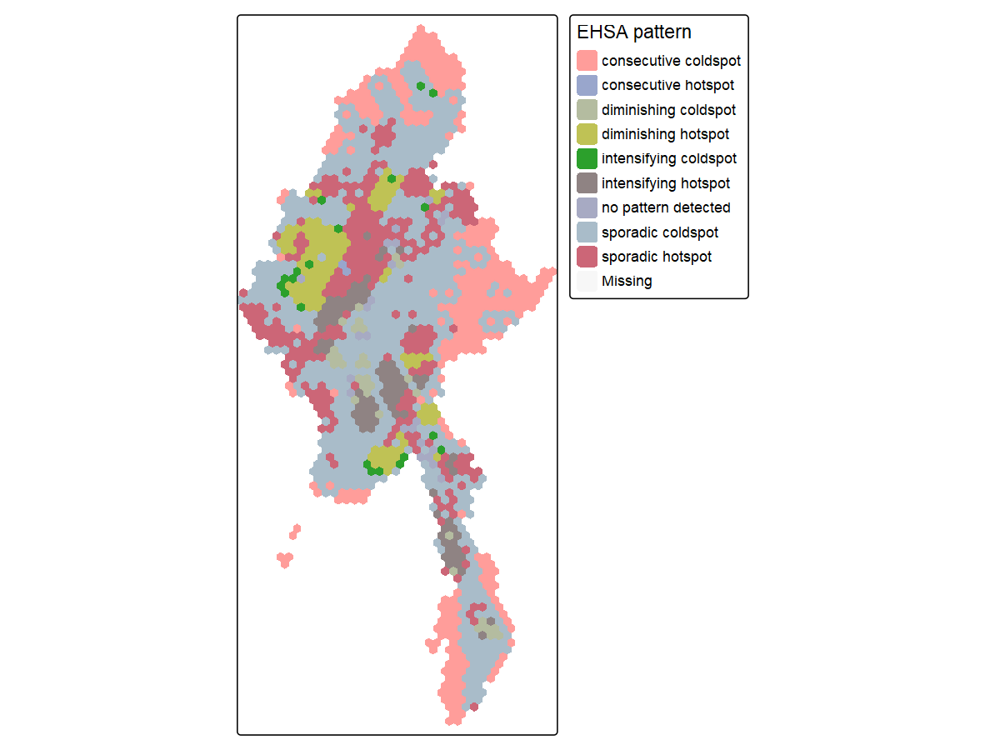

## Where this analysis looks

- Where are conflict fatalities concentrated in Myanmar?
- Is that clustering statistically real, or just chance?
- Which places are becoming more dangerous over time, not just staying dangerous?

## Study Area & Data

:::: {.columns}
::: {.column width="40%"}
- Myanmar nationwide, 325 townships
- ACLED conflict events, Jan 2021-Sep 2025
- Projected to EPSG:32646 (UTM Zone 46N, metres)
:::
::: {.column width="60%"}

:::
::::

## Methodology

- Metric: fatalities, not raw event count, to isolate real violence from protests and strategic developments
- Township-level aggregation + space-time cube: where is intensity highest
- LMSA (Getis-Ord Gi\*, 25km hexagons): is the clustering statistically real
- EHSA (Mann-Kendall + spatio-temporal Gi\*): is the hotspot getting worse, better, or staying the same

## Part 1: Where Fatalities Concentrate

:::: {.columns}
::: {.column width="40%"}
- Kale, Monywa and Shwebo have the most fatalities (1,902 / 1,814 / 1,559), all in Sagaing
- Sagaing alone totals 27,712 fatalities, more than Magway and Mandalay combined; the rest of the country barely registers (Shan East: 31, Ayeyarwady: 266)
:::
::: {.column width="60%"}

:::
::::

## Part 2: Is the Clustering Real?

:::: {.columns}
::: {.column width="40%"}
- 103 of 1,497 hexagons are significant hotspots at p<0.05, clustering in Sagaing (44), Mandalay (14) and Magway (12) — same places as Part 1
- 336 significant coldspots, mostly Shan (East) (66), Kachin (49) and Shan (South) (32)
:::
::: {.column width="60%"}

:::
::::

## Part 3: How Hotspots Are Changing

:::: {.columns}
::: {.column width="40%"}
- 89 intensifying hotspots, 109 diminishing, only 2 consecutive (out of 9 EHSA categories)
- Intensifying ones are in Bago (East), Magway, Bago (West) and Mandalay, not Sagaing — Sagaing's own hotspots are now mostly diminishing or consecutive
:::
::: {.column width="60%"}

:::
::::

## Value-Added: Civilian-Targeting Hotspots

- ACLED tags events as "Violence against civilians", so the same Gi* method was run on just this subset
- 68 hexagons are hotspots on both measures (worst by any count), mostly Sagaing, Mandalay, Magway
- 24 hexagons are civilian-targeting hotspots only: not "worst" by total fatalities, but civilians are specifically targeted there (Yangon, Mandalay, Shan North)

## Public Safety Implications

- Sagaing stays the top priority: highest-fatality region, biggest hotspot cluster, both consecutive hotspots
- Bago (East), Bago (West), Magway and Mandalay need a faster response now; EHSA flags them as intensifying even though they aren't the worst yet
- Yangon, Mandalay and Shan (North) need civilian-protection attention even though they're not overall hotspots
- Shan (East), Kachin and Shan (South) are consistent coldspots, meaning fewer reported deaths, not real safety

## Limitations & Conclusion

- UTM Zone 46N used nationwide; eastern Shan State (near zone 47N) has slightly more distortion
- Fatalities as the metric means frequent-but-low-lethality conflict areas may look quieter than they are
- Quarterly time bins smooth over any sub-quarter escalation

**Conclusion:** Sagaing looks the worst on paper, but the danger is actually moving elsewhere, and a different set of places need protection for a different reason entirely. A response built only on total death counts would miss both shifts.
