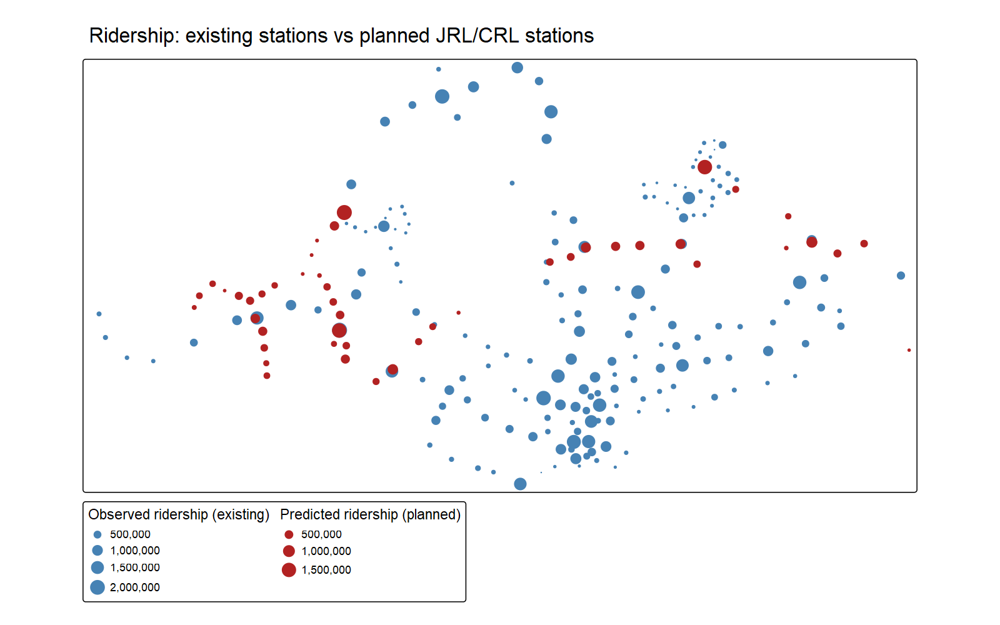

## Where this analysis looks

- How many riders will the planned Jurong Region Line (JRL) and Cross Island Line (CRL) stations draw?
- How does adding them change the catchment ("market area") of existing stations?
- Can a Huff-type spatial interaction model, calibrated on real ridership, answer both?

## Study Area & Data

- All existing MRT/LRT stations, plus planned JRL and CRL stations
- LTA passenger volume by origin-destination, Sep 2026 (887,478 trip records, aggregated to 32,048 station pairs)
- Attraction proxies: nearby bus stop count, nearby HDB building footprint area (no unit-count field available)
- CRS: SVY21 / EPSG:3414 throughout

## Methodology

- Model: Huff model -- destination choice is attraction divided by distance, normalized across competing destinations
- Calibrated as a Poisson regression with an origin fixed effect (the fixed effect absorbs Huff's per-origin normalization term)
- Distance: straight-line (Euclidean); validated with R-squared / RMSE against observed ridership

## Calibration Results

- Nearby bus stop count: strong positive effect (coefficient 0.77, highly significant)
- Nearby HDB footprint area: negligible effect (coefficient -0.008). Major interchange/CBD stations draw huge ridership despite little surrounding housing
- Distance: strong decay (coefficient -0.73), as expected
- Pair-level R-squared = 0.214; the model underestimates a few mega-interchange stations that our attraction variables don't explain

## Part 3: Predicting Ridership at New Stations

:::: {.columns}
::: {.column width="45%"}
- Planned stations treated as new competing destinations for every existing origin
- Highest predicted ridership: Choa Chu Kang, Punggol, Jurong East-area stations
- These sit right next to today's biggest interchanges, so distance decay pulls riders from the nearest large hub
:::
::: {.column width="55%"}

:::
::::

## Part 4: Market Area Impact

:::: {.columns}
::: {.column width="45%"}
- Every existing station loses some share once JRL/CRL enter the choice set: 15-24% across the board
- Biggest losers: Bukit Panjang LRT and the western East-West Line, closest to JRL
- Barely affected: City Hall, Raffles Place, Dhoby Ghaut, far from both new lines
:::
::: {.column width="55%"}

:::
::::

## Limitations & Conclusion

- HDB footprint area is a weak attraction proxy; neither variable captures interchange status or number of lines served, likely the real driver of hub-station volume
- R-squared is only 0.214, so treat the numbers as directional, not exact
- Alighting-side ridership is estimated for new stations; boarding is assumed roughly symmetric

**Conclusion:** JRL and CRL will draw the most new ridership where they sit closest to today's biggest hubs. Every existing station gives up some market share for it, concentrated in the west (JRL) and north/northeast (CRL) -- the central interchanges barely notice.
