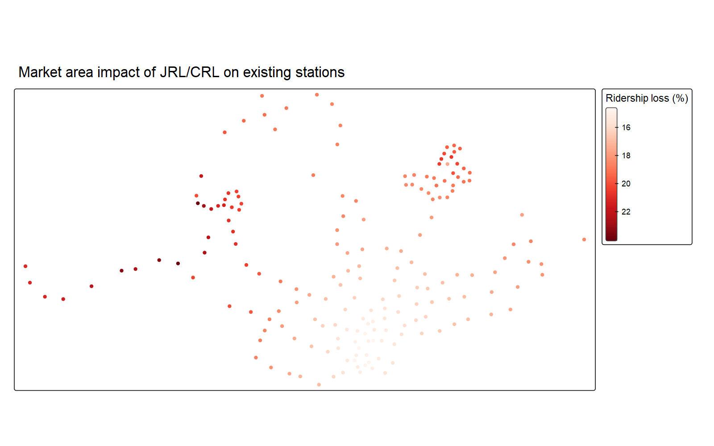

## Where this analysis looks

- Predicted ridership at the new JRL and CRL stations
- Predicted ridership loss at existing stations once the new lines open
- Both estimated with a Huff model calibrated on observed ridership data

## Study Area & Data

- All existing MRT/LRT stations, plus planned JRL and CRL stations
- LTA passenger volume by origin-destination, Sep 2026 (887,478 trip records, aggregated to 32,048 station pairs)
- Attraction proxies: nearby bus stop count, nearby HDB building footprint area (no unit-count field available)
- CRS: SVY21 / EPSG:3414 throughout

## Methodology

- Huff model: destination choice as a function of attraction and distance
- Calibrated as a Poisson regression with an origin fixed effect
- Distance: straight-line between stations
- Fit assessed against observed ridership using R-squared and RMSE

## Calibration Results

- Bus stop count: strong positive effect (coefficient = 0.77)
- HDB footprint area: negligible effect (coefficient = -0.008); top destinations are interchange/CBD stations with limited housing nearby
- Distance: expected decay, higher ridership at shorter distances
- R-squared = 0.214; underestimates ridership at several mega-interchange stations

## Predicted Ridership at New Stations

:::: {.columns}
::: {.column width="45%"}
- Each planned station treated as a new competing destination
- Highest predicted ridership: Choa Chu Kang, Punggol, stations near Jurong East
- These sit beside today's largest interchanges; distance decay draws riders from the nearest hub
:::
::: {.column width="55%"}

:::
::::

## Market Area Impact on Existing Stations

:::: {.columns}
::: {.column width="45%"}
- Every existing station loses ridership share once JRL/CRL enter the choice set: 15-24%
- Largest losses: Bukit Panjang LRT, western East-West Line (closest to JRL)
- Least affected: City Hall, Raffles Place, Dhoby Ghaut (farthest from both new lines)
:::
::: {.column width="55%"}

:::
::::

## Limitations & Conclusion

- Attraction variables do not capture number of lines served, likely the dominant driver of hub-station ridership
- R-squared = 0.214: results are directional, not precise forecasts
- New-station predictions estimate alighting volume only; boarding assumed symmetric

**Conclusion:** JRL and CRL draw the most new ridership near today's busiest hubs. Every existing station loses some predicted market share, concentrated in the west (JRL) and north/northeast (CRL), while central interchanges remain largely unaffected.
